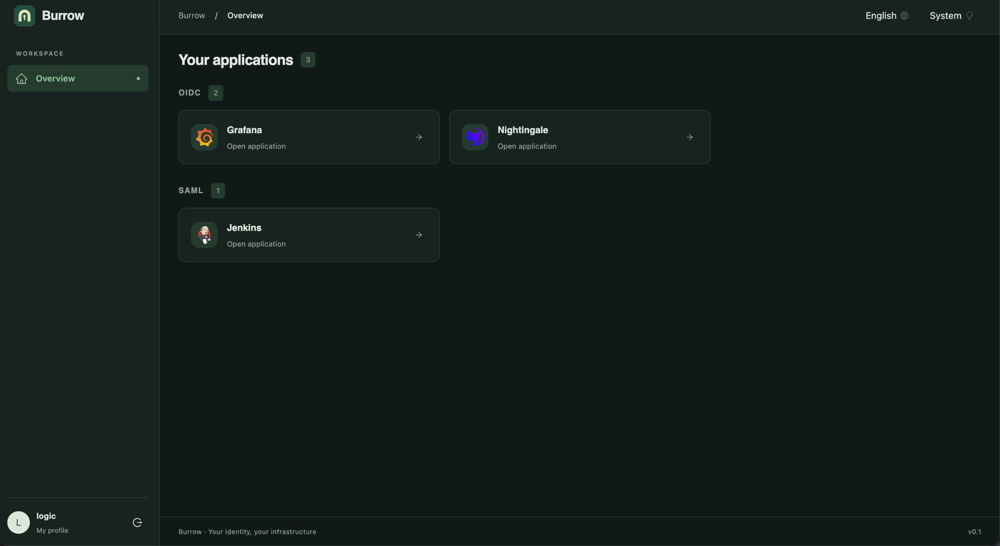
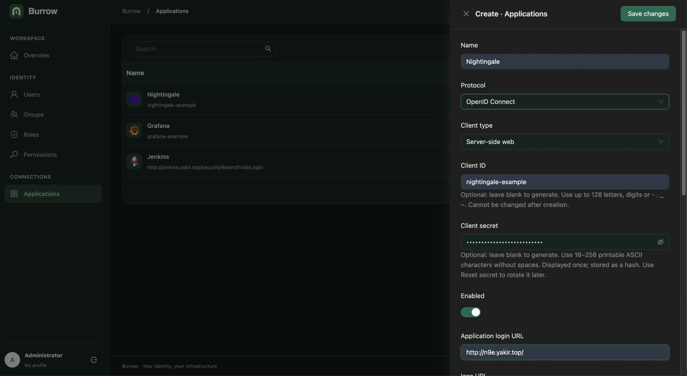
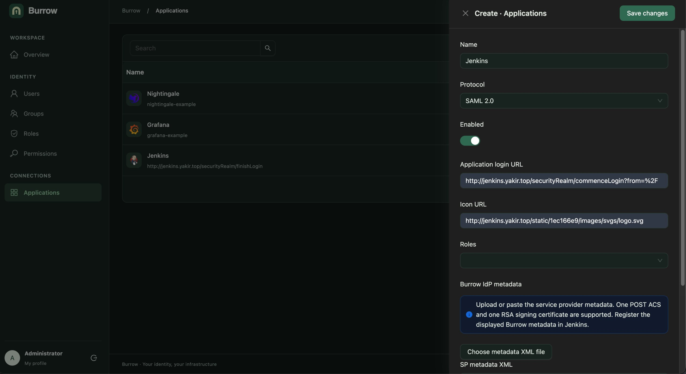
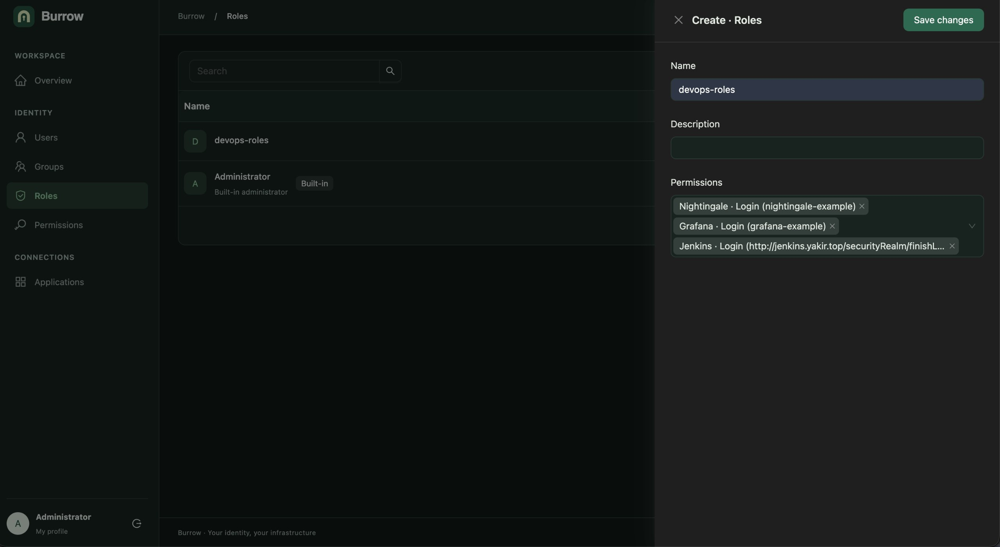
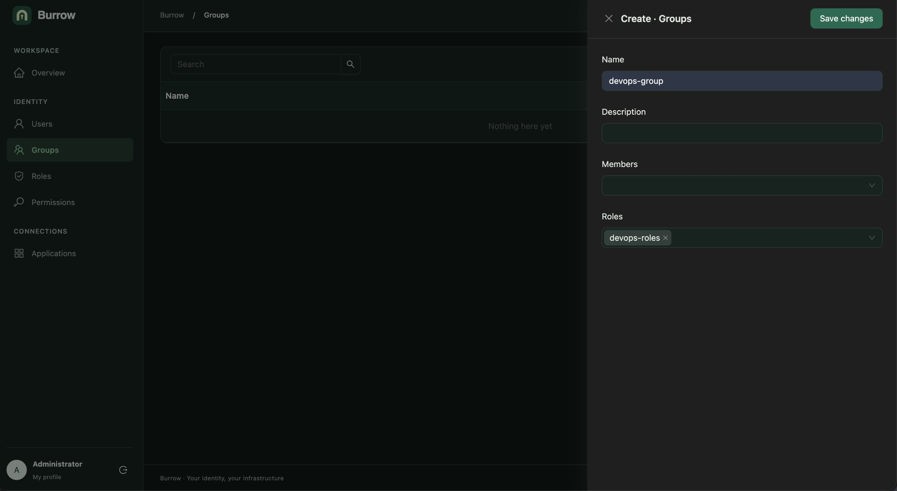
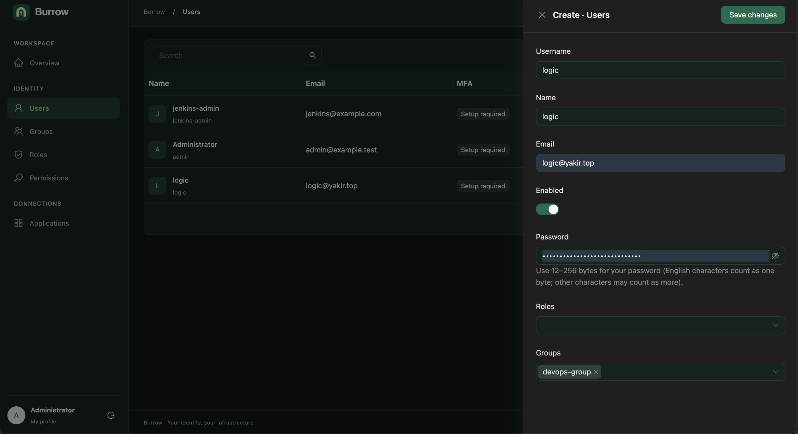

# Burrow

[](https://github.com/ArkGravity/burrow/actions/workflows/ci.yml?query=branch%3Amain)
[](https://github.com/ArkGravity/burrow/releases/latest)
[](go.mod)
[](LICENSE)

[English](README.md) · 简体中文

**面向小团队和自托管服务的轻量 OpenID Connect 与 SAML 单点登录服务。**

Burrow 集中管理账户、共享登录会话和应用访问权限，采用单组织、单实例部署。
Go 后端与 React 界面打包为一个二进制，也支持通过 Docker Compose 搭配 PostgreSQL 运行。

[版本发布](https://github.com/ArkGravity/burrow/releases) ·
[安装指南](docs/installation_zh.md) · [文档索引](docs/README.md) ·
[更新记录](CHANGELOG.md)

## 功能与适用范围

- **单点登录：** 通过 OIDC Authorization Code 接入 Web、SPA 应用，默认要求 PKCE S256。
- **SAML IdP：** 支持签名的 SP 发起 Redirect 请求、双签 POST 响应及手动配置的 [Jenkins 示例](examples/local-sso/jenkins/README.md)。
- **密码认证：** 支持临时密码改密和 TOTP MFA；MFA 默认关闭，手动开启后对所有账户生效。
- **访问管理：** 用户、用户组、自定义角色、权限、管理审计，以及展示获授权应用的个人门户。
- **双语与主题：** 英文、简体中文，以及浅色、深色和跟随系统主题。
- **简单部署：** 单二进制内嵌前端，生产使用 PostgreSQL，开发与测试支持 SQLite，无需 Redis 或队列。

项目受 Casdoor 启发并独立实现，专注 Burrow 密码登录、下游 OIDC 和约定范围内的 SAML 接入。
当前不提供上游身份联合登录、Refresh Token 或跨应用统一登出。
应用自身的会话与业务权限由应用管理，详见[协议边界](docs/development/oidc-adapter.md)。
SAML 的边界和实际互操作状态见[独立验证记录](docs/testing/saml-jenkins.md)。

## 界面预览

个人门户按协议展示当前用户获准访问的服务：OIDC 分组包含 Grafana、Nightingale，SAML 分组包含 Jenkins。



<details>
<summary>应用、角色、用户组和用户管理</summary>







</details>

[截图拍摄说明与验收范围](docs/screenshots/README.md)。

## 安装与首次登录

**推荐 Docker Compose 部署。** 发布镜像和 Linux amd64/arm64 二进制均已包含前端，
运行时无需 Go 或 Bun。使用 Compose 时安装 Docker Engine 与 Compose v2，
再从 [Releases](https://github.com/ArkGravity/burrow/releases) 下载部署包。以下示例固定版本：

```bash
BURROW_RELEASE=v1.0.0
tar -xzf "burrow_${BURROW_RELEASE}_deploy.tar.gz"
cd "burrow_${BURROW_RELEASE}_deploy"
cp .env.example .env
```

启动前编辑 `.env`：设置生产模式与实际 HTTPS issuer，配置独立主密钥和管理员密码，
并使 `POSTGRES_PASSWORD` 与 `BURROW_DB_DSN` 中的数据库密码一致。
保留部署包提供的固定镜像版本，配置 TLS 反向代理。
密钥生成与代理设置见[安装指南](docs/installation_zh.md)。

```bash
docker compose --profile local-db config --quiet
docker compose --profile local-db pull
docker compose --profile local-db up -d --no-build --pull never
```

访问配置的 HTTPS issuer，使用 `admin` 和配置的管理员密码登录，按提示修改临时密码。
Compose 自动按迁移、初始化、服务启动的顺序执行。
二进制安装、MFA 与升级步骤见[安装指南](docs/installation_zh.md)。

## 接入应用

1. 创建用户、用户组和普通角色。
2. 注册应用时选择 OIDC 或 SAML。OIDC 配置 Web 或 SPA 客户端、精确的回调地址和必要的浏览器来源；SAML 导入服务提供方元数据，并在服务提供方配置信任 Burrow 的 IdP 元数据。设置应用登录地址，供门户跳转使用。
3. 将 `app:<应用 ID>:login` 权限加入角色，再把角色分配给用户或用户组。
4. 用户在门户中按 OIDC / SAML 分组查看获授权应用，由应用发起相应的认证请求。

Administrator 是唯一内置角色。新用户默认没有角色，登录后即可使用个人资料与门户。
除管理员外，访问应用需要通过角色明确授权。

接入示例：[独立 Web / SPA 客户端](examples/README.md)、
[Grafana / Nightingale / Harbor](examples/local-sso/README.md)、
[Jenkins SAML](examples/local-sso/jenkins/README.md)。

## 开发与贡献

按[开发指南](docs/development/getting-started.md)准备 Go、Bun、Make 和 C 编译器，
在源码仓库根目录执行：

```bash
make deps
make migrate
make seed
make run       # 后端：http://localhost:8080
```

另开终端执行 `make web-dev`，访问 http://localhost:5173。
开发账号、本地配置、构建和检查步骤见[开发指南](docs/development/getting-started.md)。
问题反馈与 PR 请参阅[贡献指南](CONTRIBUTING.md)，漏洞通过[安全报告入口](SECURITY.md)私密报告。

## 文档与许可证

- [文档索引](docs/README.md)
- [配置与 MFA 策略](docs/development/configuration.md)
- [备份、升级与 MFA 恢复](docs/operations/recovery.md)
- [验证范围与验收记录](docs/testing/oidc-conformance.md)

Burrow 使用 [MIT 许可证](LICENSE)。
